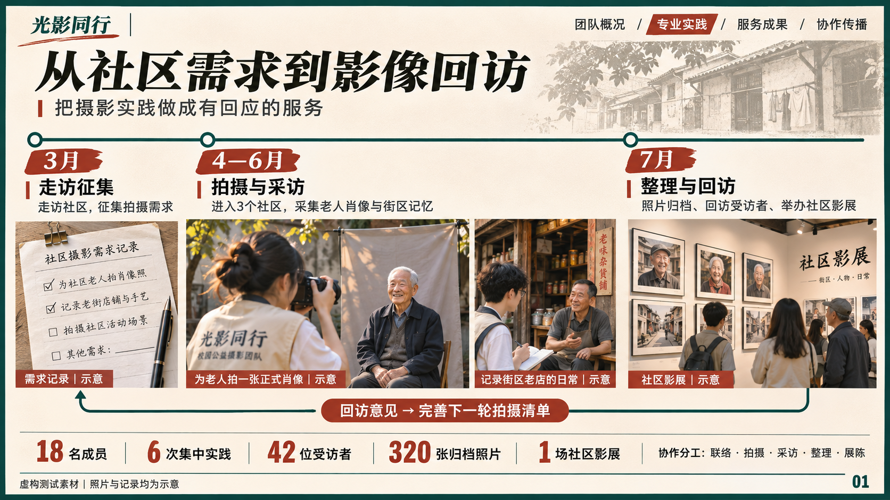
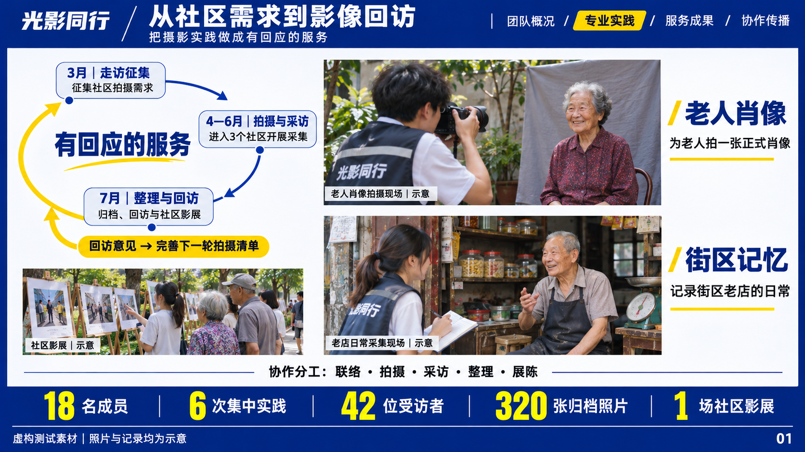
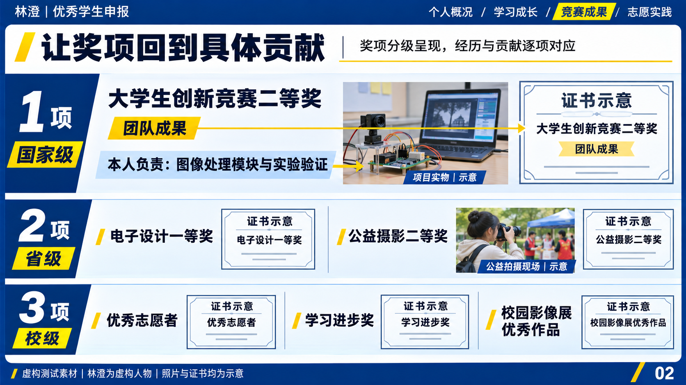
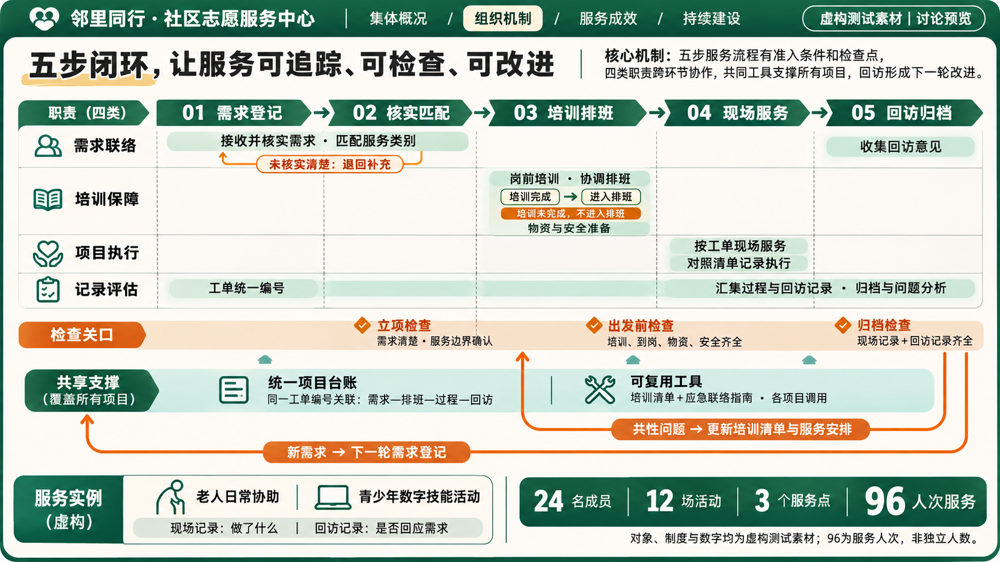

# 评奖评优答辩 PPT Skill

面向个人、团队、组织及其他集体的**非学术评奖评优答辩**，将素材组织成内容饱满、图文丰富、层次清楚的演示文稿。

支持从零制作、模板填充和已有 PPT 修改。输入可以是一份素材文档、零散文字与照片、一套参考模板，或需要继续完善的半成品。论文、项目与专利可以作为评优成果；当前技能不用于学术、技术或毕业答辩。

本 Skill 负责内容取舍、设计决策与协作流程，具体可编辑 PPTX 的绘制、转换和检查由 PPT Master 等制作技能或合适脚本完成。

## 能做什么

- 根据本次评价标准梳理优势、行动、贡献、成果与证据，确定主线及每页要说明的问题。
- 按内容关系设计整张正文页：层级、金字塔、时间线、流程、循环、中心辐射、支撑结构、对照、矩阵及复合布局。
- 安排文字、照片、证书、报道、数字与图表，兼顾信息密度、视觉层级和证据可读性。
- 建立统一的边框层次、章节导航、字体角色与图注语言，同时让不同页面采用不同构图。
- 在方向不明确时，用相同主要内容提供实质不同的视觉方案；颜色、字体、页数和页序不固定。
- 规划共享对象、焦点放大、照片带滑动与导航高亮等连续展示，并在正式制作阶段核看实际效果。
- 在用户修改文件后，以最新人工版继续，保留已确认内容与未涉及页面。

## 效果例图

以下为独立试用时生成的**风格与排版讨论预览**。名称、经历、数字、照片与证书均为虚构或示意，不是用户真实成果。它们不是固定模板，也不自动成为以后任务的审美标准。

### 同一份集体实践素材，两种方向

**方向 A：纪实画册与时间主轴。** 按阶段分配正文空间，将拍摄、采访、回访和作品证据对应。



**方向 B：公共影像展陈与反馈循环。** 主要事实不变，改变字体气质、整页框架和图形语言。



### 个人奖项：分级成果与本人贡献

用跨页分层带组织不同等级的奖项，分别说明团队归属、本人职责与证据位置。



### 集体机制：多阶段、多职责与共同支撑

用阶段与职责通道统领正文，加入检查点、共同工具、反馈和关键数据，展示更高的信息密度。



预览用于确认风格、构图、图文比例、信息密度与层级。局部文字、连线贴合等细节由正式绘制落实；成品依据真实材料与确认方案核对，并检查可编辑性、素材替换和实际放映。

## 安装

将仓库直接克隆到 Codex 的个人技能目录：

```bash
git clone https://github.com/cstkn/awards-defense-ppt.git ~/.codex/skills/awards-defense-ppt
```

若已配置 `CODEX_HOME`，将目标目录替换为其下的 `skills/awards-defense-ppt`。目录已存在时先保留本地修改，避免覆盖。

更新仓库安装的版本：

```bash
git -C ~/.codex/skills/awards-defense-ppt pull --ff-only
```

在支持 Codex Skill 的环境中使用。正式 PPTX 制作优先协调可用的 `ppt-master`；该技能未捆绑在本仓库中。生图预览使用当前环境可用的图像生成能力，实际显示和导出可使用 WPS 等支持 PPTX 的软件。

## 如何使用

可以通过 `$awards-defense-ppt` 明确调用，并提供素材文件与当前目标。例如：

```text
使用 $awards-defense-ppt，帮我制作优秀实践团队答辩 PPT。

评选要求、经历和统计在附带文档中，照片在素材文件夹中。
限时 5 分钟，目前没有 PPT，也没有明确风格。
请先梳理主线并给出视觉方向，再展示整稿缩略图与关键页预览。
```

已有模板或半成品时：

```text
使用 $awards-defense-ppt 修改这份评优答辩 PPT。

以我上传的最新版本为准。模板的配色、边框和导航必须保留，
正文构图可以调整；新增的成果材料见附带文档。
请先提出章节或文案调整方案，并给出待改页面预览。
```

建议一并说明参评对象、评价标准、时限、必须保留的信息，以及模板是固定要求还是借鉴方向。素材已经回答的内容不必重复填写；关键缺口会集中询问。

## 制作流程

1. 阅读材料与现稿，识别评价目标、证据及模板约束。
2. 提炼主线，安排每页结论、信息关系、整页框架与证据位置。
3. 选择视觉方向与布局；必要时提供多个方案。
4. 展示内容方案、整稿或全部待改页面的缩略图总览与关键大图，确认后继续。
5. 向制作技能交接已确认内容、视觉固定项、真实素材与动效要求，绘制可编辑成品。
6. 对照确认方案检查实际渲染、编辑能力、证据可读性及需要的放映状态。
7. 交付可编辑 PPTX 与静态预览，讲稿按需提供；后续沿最新人工修改版继续。

重大文案、章节或页面拆并先给具体方案。已有确认在其范围内继续有效，不重复询问。真实素材、个人/团队贡献与数据口径始终优先。

## 文件入口

| 文件 | 用途 |
|---|---|
| [SKILL.md](SKILL.md) | 适用范围、主要设计约束、协作与交付规则 |
| [制作流程](references/production-workflow.md) | 从读取材料到预览、制作、检查与交付 |
| [图解方法库](references/pattern-library.md) | 将示例、适用内容、提炼方法与调整边界放在一起 |
| [整页布局与可编辑构建](references/page-layouts.md) | 根据真实关系搭建正文框架，附结构 SVG/PNG 与正文区范例 |
| `assets/` | 与方法对应的参考节选、裁剪图和 17 类结构 SVG/PNG |
| `examples/` | 本 README 展示的虚构测试预览，不作为正式事实或默认模板 |

参考材料用于理解设计方法。新稿按当前内容重新决定布局与外观，不复制示例中的身份、数据或成果，也不沿用来源稿的固定页序。
