# 关系驱动的整页布局与可编辑构建

用于个人或各类集体的非学术评奖评优正文页。先由内容关系搭建整页框架，再组织文字、图片、数字与证据，最后设计局部构件。章节、页序、内容分类和外观由当前任务决定。

## 使用方式与选型

先写出本页要说明的结论，辨别材料之间的关系，再选择相应条目。将外框、标题和固定导航留在全稿统一的位置，在其余正文区设计主构图。用主轴、分层、中心、路径或对应区域确定阅读顺序，并给重要证据预留可读面积。

整页框架可以是显性的金字塔、飞轮等几何结构，也可以通过隐性的层面、对齐与阅读路径体现。局部图解服务所属区域。图形复杂度随内容需要确定，不要求每页都有一个占满画面的巨大图标。

材料中的多层支撑、跨阶段职责、条件分支和反馈可以在一张正文页共存。用主流程、层面或区域确立阅读主线，再以通道、分支、标签和必要连接组织其他关系；保留有解释价值的细节，不默认压成几个关键词，也不为追求复杂而补造关系。信息过量时提出分步展示或拆页。

| 本页真实关系 | 可选整页思路 |
|---|---|
| 成果等级、基础与上层、逐级递进 | 金字塔、阶梯、分层平台 |
| 组织从属、职责分工 | 树状分支、分层平台、并列职责通道 |
| 时间、发展阶段、行动步骤 | 横向时间线、纵向主轴、道路、流程通道 |
| 行动、反馈与下一轮改进 | 循环、飞轮；有真实相互促进关系时突出驱动 |
| 一个主题的多个方面 | 中心辐射、并列扇区或花瓣、周边证据 |
| 多个方向共同支撑目标 | 屋顶与支柱、向目标汇聚的路径 |
| 两条主线或两组作用 | 双核心、两侧展开、交汇与对应 |
| 起点问题与响应行动、前后变化 | 对照区域、逐项对应、连接两侧的中心转折 |
| 同级事项、多个分类维度 | 并列通道、分组列表、矩阵 |
| 规模、分布、趋势与重点成效 | 主数据图、总量与分布分层、证据旁注 |

参考图中的商业、教学或研究文字仅帮助识别原有关系，不提供新稿事实，也不规定答辩类别。正文区大图展示可见空间安排；清晰 PNG/SVG 展示基本结构。两类参考结合使用，按任务重画外观、节点与内容。原图上的标记不进入成品。

## 金字塔与阶梯：让层级统领整页

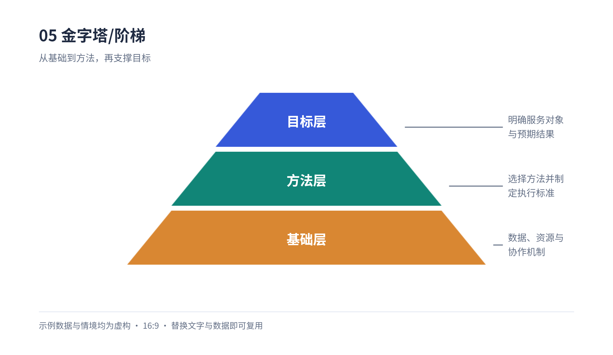

**内容关系：**不同等级成果、基础与目标、能力递进等。组织架构有多条从属分支时优先采用树状或分层平台，不能仅用上下位置替代真实从属关系。

**整页构建：**让分层主体成为正文区的主要空间结构。每层安排名称、关键数量或短结论；在相同高度的两侧接解释、代表案例、照片或证书，引导线指向所属层。证据较多的层获得更宽的说明区，关键证书可在侧边单独放大，其他证据以缩略组补充广度。

**变化与边界：**文本较长可采用阶梯、横向层带或一侧展开；层数按真实内容确定。几何面积不代表数量，成果按等级呈现也不推断必然包含关系。国家级、省级等分类应按真实评奖口径归类。

**可编辑构建：**独立的分层形状、层级标题、数字、说明与证据图组；参照 [SVG](../assets/structural-samples/svg/05_金字塔·阶梯.svg) 理解节点与标注后重新分配空间。

## 分层平台与组织分支：基础、机制、行动或成果

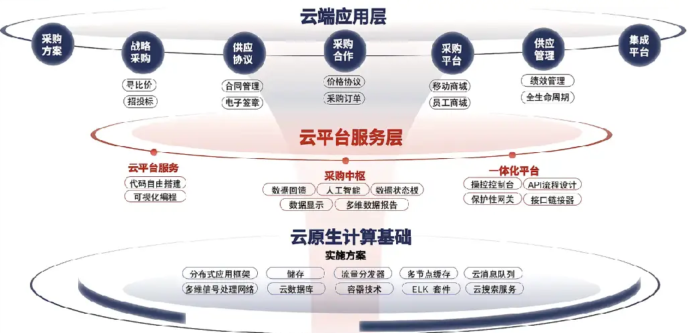

**内容关系：**多个层面共同组成一个体系，或明确的上下级与职责。示例只提取层面与节点组织；层名由本次材料决定。

**整页构建：**用跨页宽的层面容纳同层事项，短说明紧邻节点，重要照片或成果靠近对应层。层间用留白、细线和必要连接体现关系；纵向层级形成阅读主线。组织关系采用根节点与分支时，将职责解释、负责人或代表活动靠近相应分支。

**变化与边界：**可以使用平面层带、错位平台或树状布局；无需复制示例椭圆、透视、投影与技术术语。基础支撑、上下级与先后步骤含义不同，连接方式随真实关系确定。

**可编辑构建：**层面底板、节点、标签、连接及证据独立；分支基本结构可查 [PNG](../assets/structural-samples/png/04_组织·层级.png) / [SVG](../assets/structural-samples/svg/04_组织·层级.svg)。

## 时间线与阶段：让图文沿主轴展开

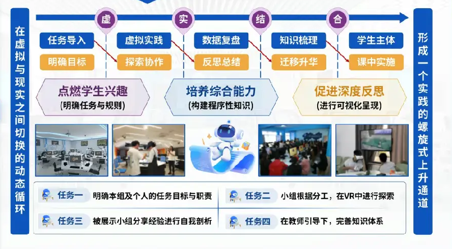

**内容关系：**个人成长、项目历程、服务推进或建设阶段等真实顺序。

**整页构建：**横向或纵向主轴贯穿正文区。阶段标题靠近节点，行动、照片和结果围绕所属阶段排列；可上下交错，也可按“行动—证据—结果”形成平行信息带。起点与终点说明放在轴两端或独立侧区，突出关键转折阶段。

**变化与边界：**按阶段重要性和证据量分配宽度；阶段过多可分组、换为纵轴或分步展示。只有表达真实时长时才按时间比例设距离。照片不要被压缩成无法辨认的装饰条，阶段标题也不承担全稿章节导航。

**可编辑构建：**主轴、节点、日期、阶段标题、图文证据及图注成组对应。基本结构见 [时间线 PNG](../assets/structural-samples/png/01_时间线·里程碑.png) / [SVG](../assets/structural-samples/svg/01_时间线·里程碑.svg)；多行对应可用阶段矩阵。

## 流程、大箭头与通道：从输入到行动和产出

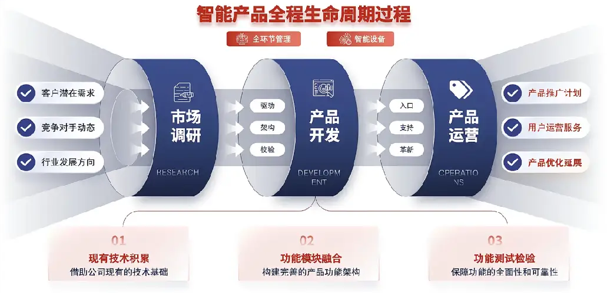

**内容关系：**工作开展步骤、服务路径、问题解决过程等。

**整页构建：**用大箭头、道路或连续通道作为主构图。步骤标签处于主线上；各步骤的动作、方法或证据就近展开。两端交代输入和输出，基础条件可放在下方支撑带。主线形成视觉连续性，局部允许采用图片、列表或关系图。

**变化与边界：**步骤长短和节点数按材料确定，长流程可折转或分段；简短流程可以给证据留更多面积。步骤先后不自动等于因果关系，原图的立体管道只是可选造型。

**可编辑构建：**路径或箭头底板、阶段节点、连接、说明及证据。查看 [PNG](../assets/structural-samples/png/02_流程·大箭头·道路.png) / [SVG](../assets/structural-samples/svg/02_流程·大箭头·道路.svg)。

## 循环与飞轮：让环节及其证据围绕机制展开

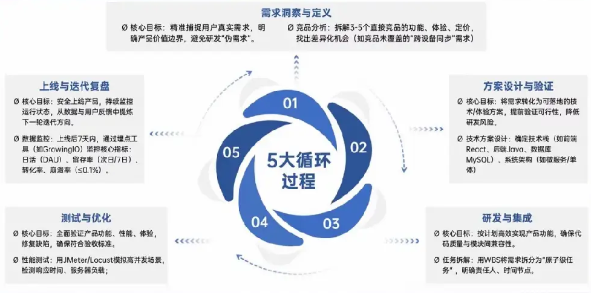

**内容关系：**工作经过行动、反馈和改进形成下一轮；飞轮还需要环节之间真实的相互促进。

**整页构建：**中心写机制或本页核心结论，环节沿闭合路径排列。外围的行动、反馈材料、数据或照片与所属环节逐项对应；说明区用标签或细引导线连接，较长内容可以放在上下或两侧，不必沿圆弧挤排。明确起点、方向及回流含义。

**变化与边界：**环节数取决于真实过程；可以采用开放椭圆、花瓣或环带，保持说明可读。只有并列方面而没有反馈时，采用无回流箭头的中心辐射。避免用花哨的多重圆环填补缺失环节。

**可编辑构建：**中心标签、独立环节、方向箭头、周边图文与证据；查看 [PNG](../assets/structural-samples/png/03_循环·飞轮.png) / [SVG](../assets/structural-samples/svg/03_循环·飞轮.svg)。

## 中心辐射与并列扇区：一个主题的多个方面

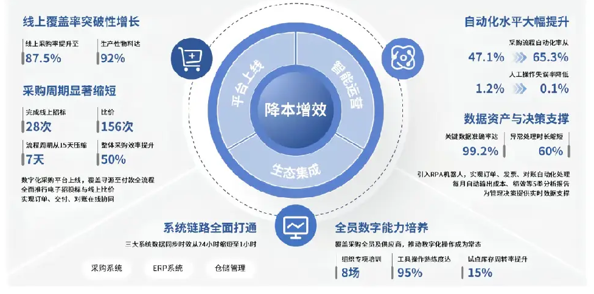

**整页构建：**将中心命题与若干方面形成主要视觉结构，四周安排与各方面对应的解释、图片或数据。信息量不同可用不等宽说明区，少量关键数字独立强调。图形与周边内容共同决定整页平衡，中心不要成为只有名称而没有内容关联的装饰。

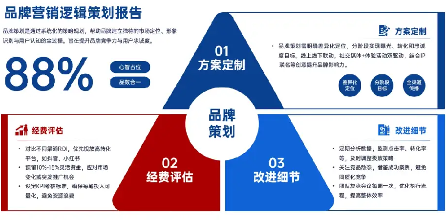

**关系判断：**该三角形示例的内部是三个并列方面，整体三角外形不构成金字塔层级。同样，圆形外观也不自动表示循环或占比。

**变化与构建：**按内容采用扇区、花瓣、分支、蜂巢或不规则分区；主题标签、方面节点、连接及图文分别可编辑。结构示意见 [PNG](../assets/structural-samples/png/08_中心辐射·圆形矩阵.png) / [SVG](../assets/structural-samples/svg/08_中心辐射·圆形矩阵.svg)。

## 屋顶、支柱与汇聚：多个方向支撑共同目标

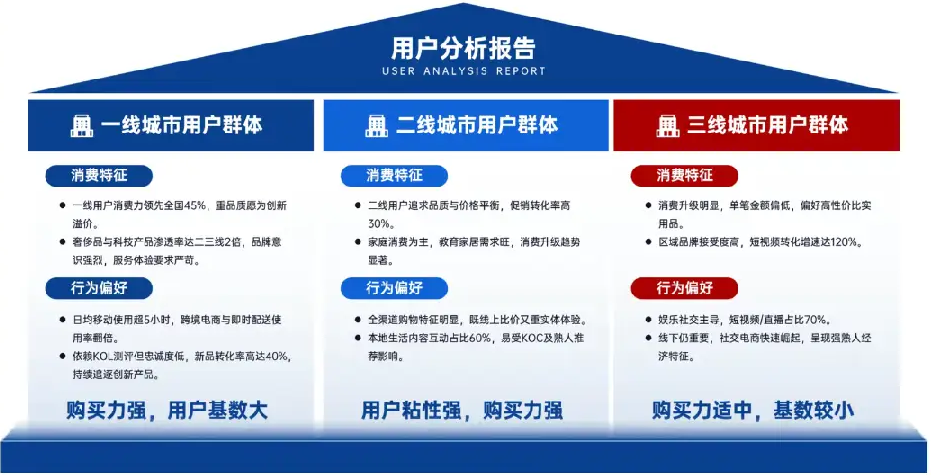

**整页构建：**共同目标放在顶部或汇聚处，若干支撑方向占据正文主区。每个方向包含短标题、关键行动及相应证据；底部可以放共同基础或已证实的综合结果。支柱作为完整的内容通道，其内部结构可随材料变化。

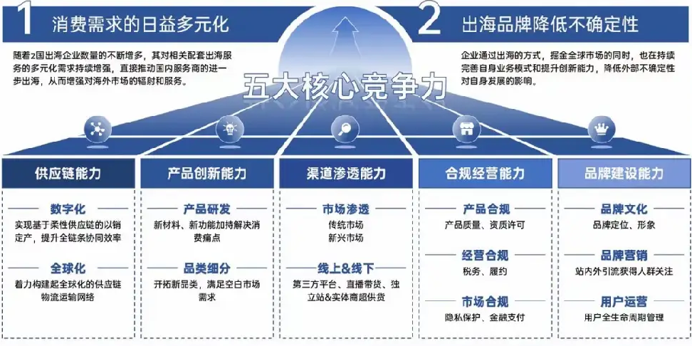

**变化与边界：**可以采用抽象梁柱、桥梁、坡道或汇聚线；形态随主题设计。此类结构表达并行支撑，不能把左右柱子误读成时间阶段，或把屋顶当作金字塔的顶级成果。综合结果需有材料依据。

**可编辑构建：**目标形状、支撑分区、基础带、标题、图文与必要连接。基本结构见 [PNG](../assets/structural-samples/png/06_支柱·房屋结构.png) / [SVG](../assets/structural-samples/svg/06_支柱·房屋结构.svg)。

## 双核心与两侧展开：两条主线的联系

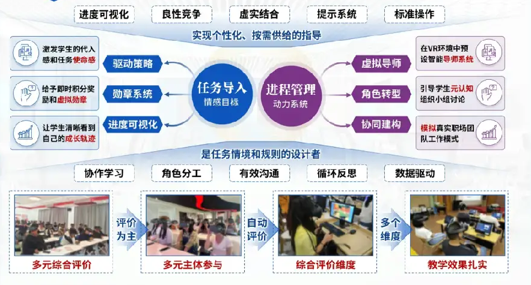

**内容关系：**两类行动、两项机制、个人与团队协作等确有联系的两条主线。

**整页构建：**两个核心占据正文中部，各自向所属一侧展开行动与解释。共享条件可置于上方，联合成果或现场证据放在下方；相互作用在两核心之间说明。若材料是问题与响应，采用下面的对照方法。

**变化与边界：**两侧可以有不同宽度、分支数和证据量；不必强做镜像。交集、双向影响和普通并列含义不同，只使用有依据的连接。

**可编辑构建：**独立核心、分支标签、解释和图片组；连接线绕开文字，必要时标明作用。相同图片可在相邻页放大展开并维护对象对应。

## 问题与行动、前后对照：建立逐项对应

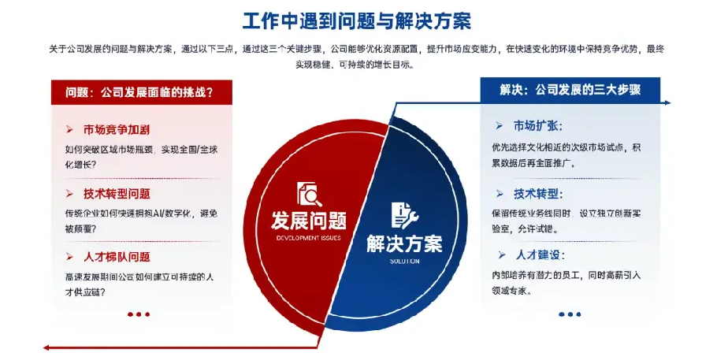

**整页构建：**以左右、上下或交错的对应区域展开问题与行动，中心图形或贯穿线表达转折。问题描述、响应动作和结果在相应位置对应；照片或数据紧邻其支持的事实。两侧字段协调，关键变化优先被看见。

**变化与边界：**多个问题可以由同一行动解决，也可以一一对应，连线要按事实决定。前后比较统一对象、时间范围和统计口径；不通过任意面积或虚构增长箭头暗示改善。长内容可以改为逐行对照，不强留中心圆形。

**可编辑构建：**对应底板、标题、短文本、连接与证据；两侧的装饰造型随全稿风格设计。

## 并列通道与分组列表：同级事项、内部变化

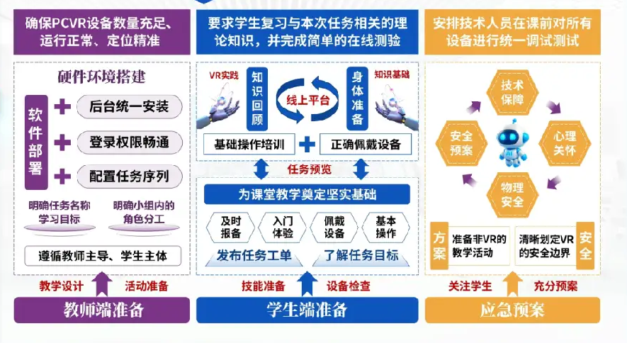

**整页构建：**以共同字段建立同级通道或记录，标题、关键结果与证据边界协调。每个通道内部可以分别采用步骤、列表、照片组或小型关系图；较长事项可改为横向记录或错落布局。参考 [PNG](../assets/structural-samples/png/07_分组列表.png) / [SVG](../assets/structural-samples/svg/07_分组列表.svg)。

**变化与边界：**同级事项数量和文字量决定分区，不固定三栏。存在主次时分配不同面积，存在层级时改用相应结构。只有分类需求时使用分组即可，无需添加虚构箭头。

**可编辑构建：**通道标题、分组底板、各自的图文与局部关系分别保留；统一同级字体与间距，但不要求内层构图完全相同。

## 纵向主轴与纲要：一条线索统领多个区域

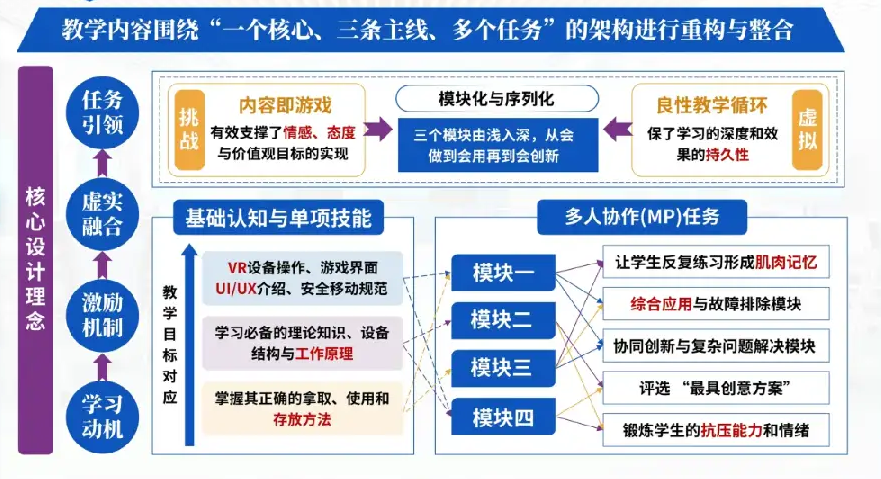

**整页构建：**一侧以纵轴、短标签或节点概括主线，另一侧展开对应的行动、机制或成果。内容较多时可形成上方总述、下方分区，但要标明这些分区与主线的关系。文字、流程、照片和小表格可以组合。

**变化与边界：**纵轴可表示时间、层级或纲要分类，先明确其中一种含义；普通分类不使用递进箭头。各区域按信息量分配高度，避免长侧栏占据主体面积。

**可编辑构建：**主轴标签、正文分区、相应图文与连线。复杂多对多连接只在确有解释价值时使用。

## 矩阵、象限与旅程：让两个维度组织空间

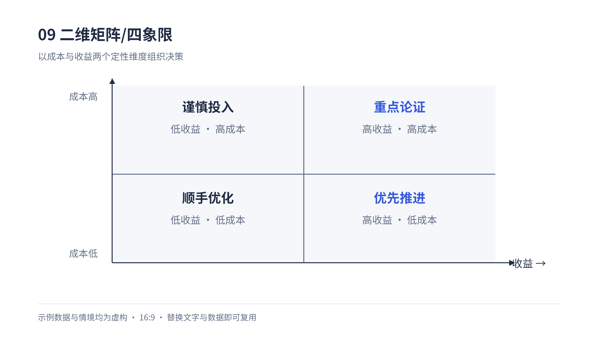

**整页构建：**用两个明确维度组织正文区，如阶段与行动类型、服务对象与工作内容。每个区域放相应的短结论、数字、照片或证据；行列标签清楚，重点区域可放大。分类矩阵的格子可采用开放分区，不一定绘制完整表格线。

**变化与边界：**阶段旅程适合多行字段随阶段对应；象限要求两轴含义清楚。条目太长时保留主维度，另一维度用标签表示。没有数值依据的分类不伪装精确坐标。

**可编辑构建：**轴线或行列、区域标签及图文独立。查看 [矩阵 SVG](../assets/structural-samples/svg/09_二维矩阵·四象限.svg)、[阶段 PNG](../assets/structural-samples/png/14_阶段·旅程矩阵.png) / [SVG](../assets/structural-samples/svg/14_阶段·旅程矩阵.svg)。

## 数据统领：总量、结构、趋势与证据分工

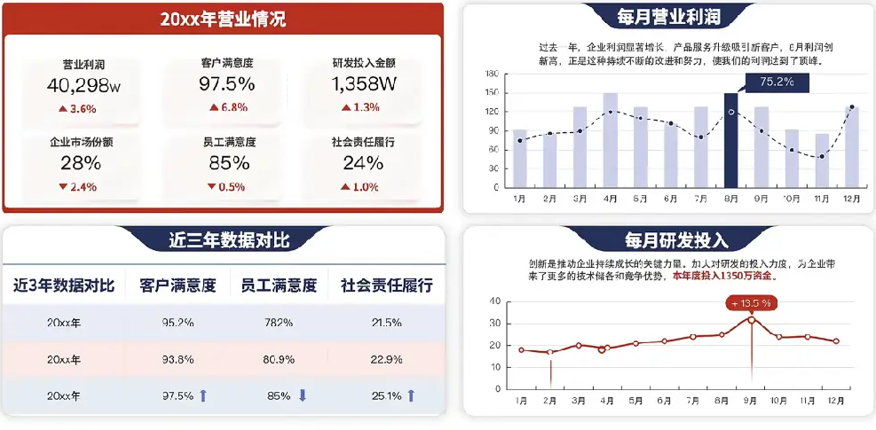

**整页构建：**以最能支持本页结论的数据图或关键数值形成视觉中心，再安排解释原因的分布、比较与证据。可以采用一幅主图配少量旁注、总量上方与分布下方、或少数清晰数据区域；图表面积按阅读任务分配，不预设仪表盘。

**变化与边界：**图型由数据关系决定。原图只支持观察分区方式，不沿用其中数字、装饰箭头或未经核实的结论。照片、证书和报告用于支撑相应结果；数据不足时采用真实条目与证据展示。

**可编辑构建：**真实数据、可编辑图表、单位、直接标签、注释和图片；关键数字的大小与颜色形成层级，背景与边框保持全稿统一。

## 主图与复合布局：用一种主关系统领局部方法

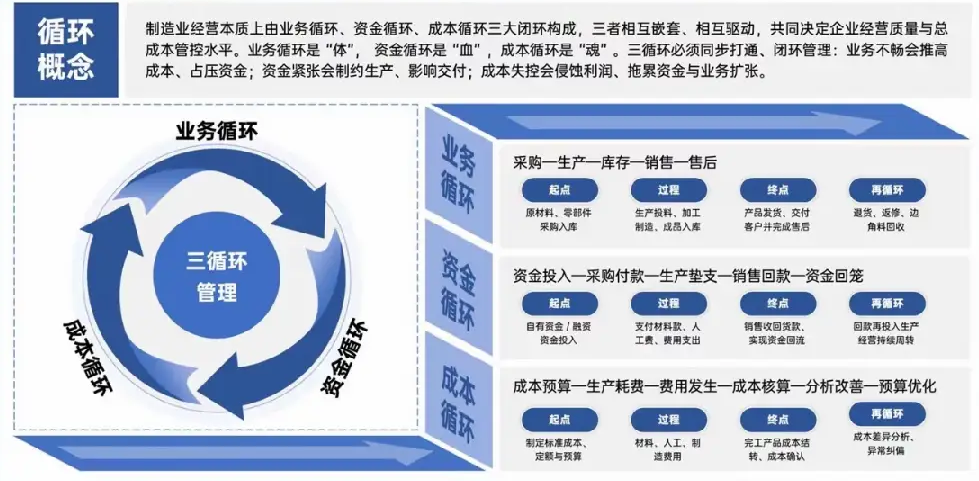

**整页构建：**先确定一个占主导的关系，再加入解释所需的局部结构。例如左侧循环概括机制，右侧按环节展开行动与结果；或以代表照片、成果图作为中心，周边安排解释与其他证据。各区域通过对齐、编号、颜色或明确连接对应。

**变化与边界：**图形只是局部时，其余空间也要按本页结论组织。信息太多可分步揭示或提出拆页，不能把所有方法同时堆进一张页面。照片墙、证书墙及纯文字图解同样可以成为有效主构图。

**可编辑构建：**分别维护主框架、局部图解、图片、图注及跨页共享对象。通过图层与分组保留可修改性，制作后检查实际显示与必要的连续运动。

## 结构示意与可编辑实现

以下 17 类 PNG 与 SVG 是结构参考，按所选关系查阅对应项即可。SVG 中的示例文字、数据、页脚和默认配色均需按任务重做。插入 SVG 不等于其中每段文字都已成为 PPT 原生可编辑对象；最终标题、正文、数字、表格及需要连续运动的节点按制作技能构建。

| 结构 | 选型与构建条件 | PNG / SVG |
|---|---|---|
| 时间线、里程碑 | 真实时间或阶段顺序；节点邻接动作与证据，仅在表达时长时按比例设距 | [PNG](../assets/structural-samples/png/01_时间线·里程碑.png) / [SVG](../assets/structural-samples/svg/01_时间线·里程碑.svg) |
| 流程、大箭头、道路 | 真实先后步骤，动作与产出靠近对应节点，长说明放相邻区域 | [PNG](../assets/structural-samples/png/02_流程·大箭头·道路.png) / [SVG](../assets/structural-samples/svg/02_流程·大箭头·道路.svg) |
| 循环、飞轮 | 真实反馈闭环，飞轮需环节相互促进；中心、方向和外围证据明确 | [PNG](../assets/structural-samples/png/03_循环·飞轮.png) / [SVG](../assets/structural-samples/svg/03_循环·飞轮.svg) |
| 组织、层级 | 真实从属、分工或支撑关系；同级对齐，层间留连接通道 | [PNG](../assets/structural-samples/png/04_组织·层级.png) / [SVG](../assets/structural-samples/svg/04_组织·层级.svg) |
| 金字塔、阶梯 | 真实层级或递进；分层图形和侧边说明，面积不冒充数量比例 | [PNG](../assets/structural-samples/png/05_金字塔·阶梯.png) / [SVG](../assets/structural-samples/svg/05_金字塔·阶梯.svg) |
| 支柱、房屋 | 多个方向共同支撑目标，基础、方向与目标分别组织 | [PNG](../assets/structural-samples/png/06_支柱·房屋结构.png) / [SVG](../assets/structural-samples/svg/06_支柱·房屋结构.svg) |
| 分组列表 | 同级分类与条目，不额外编造因果；可加入对应图片与结果 | [PNG](../assets/structural-samples/png/07_分组列表.png) / [SVG](../assets/structural-samples/svg/07_分组列表.svg) |
| 中心辐射、圆形矩阵 | 中心与各方面真实相关，图文靠近相应分支 | [PNG](../assets/structural-samples/png/08_中心辐射·圆形矩阵.png) / [SVG](../assets/structural-samples/svg/08_中心辐射·圆形矩阵.svg) |
| 二维矩阵、四象限 | 两维含义明确，无数值时不伪装精确坐标 | [PNG](../assets/structural-samples/png/09_二维矩阵·四象限.png) / [SVG](../assets/structural-samples/svg/09_二维矩阵·四象限.svg) |
| 韦恩、嵌套圆 | 真实交集或包含，明确重叠含义，不推定占比；多用于局部关系 | [PNG](../assets/structural-samples/png/10_韦恩·嵌套圆.png) / [SVG](../assets/structural-samples/svg/10_韦恩·嵌套圆.svg) |
| 甘特、排期 | 实际任务起止与并行关系，时间刻度一致；常用于安排页 | [PNG](../assets/structural-samples/png/11_甘特·排期.png) / [SVG](../assets/structural-samples/svg/11_甘特·排期.svg) |
| 漏斗 | 同一批对象逐级筛选或减少，层旁写条件、数字和单位；普通步骤改用流程 | [PNG](../assets/structural-samples/png/12_漏斗.png) / [SVG](../assets/structural-samples/svg/12_漏斗.svg) |
| 靶心、目标图 | 目标与外围行动、资源或范围对应，分清聚焦、包含与数值距离 | [PNG](../assets/structural-samples/png/13_靶心·目标图.png) / [SVG](../assets/structural-samples/svg/13_靶心·目标图.svg) |
| 阶段、旅程矩阵 | 阶段作列，动作、角色、证据等作行，维度来自真实材料 | [PNG](../assets/structural-samples/png/14_阶段·旅程矩阵.png) / [SVG](../assets/structural-samples/svg/14_阶段·旅程矩阵.svg) |
| 柱形、折线 | 真实数据、单位与可比尺度；折线有连续顺序；重点用注释指出 | [PNG](../assets/structural-samples/png/15_柱形·折线.png) / [SVG](../assets/structural-samples/svg/15_柱形·折线.svg) |
| 饼、环形 | 明确整体与真实占比，独立成绩不能强行相加；优先直接标签 | [PNG](../assets/structural-samples/png/16_饼·环形.png) / [SVG](../assets/structural-samples/svg/16_饼·环形.svg) |
| 雷达 | 真实分值、明确维度与可比量尺；无分值时改用分组或辐射图 | [PNG](../assets/structural-samples/png/17_雷达.png) / [SVG](../assets/structural-samples/svg/17_雷达.svg) |

生图预览用于选择风格与整页构图；节点位置和连线贴合等细节，在原生或脚本绘制时落实，不要求先将预览修成精确工程图。实际构建时依次处理主框架、文字与证据、连接、细节；线条按页面方案核对起止、方向与条件，尽量避开文字和图像主体。层级可以通过面积、字号、字重、深浅底与位置共同表达。自由曲线、异形底板和标题签可增强分区与引导，但不改变内容关系。

检查成稿时，先看整页是否表达清楚结论，再看局部造型。图文与所属节点对应，证据仍可辨读，字体、外框、导航与图注和全稿一致。需要连续展示的框架、节点、照片和图注分别保留对象身份，核看目标软件中的实际放映。
