# 图解方法库

按本页需要表达的问题查找条目，在同一条目内查看图片、方法和调整边界。条目提供页面表达与局部设计方法，不是章节列表或整稿模板；来源页码仅作定位。按真实内容重新决定页数、页序、构图、配色、具体字体和组件组合。

完整页面用于观察可见构成，局部图只支持可见模块，缩略拼图只支持宏观节奏。宣传外框和 App 界面不属于 PPT 内容。每个方法先明确内容关系与可编辑构建，再用图片核对可辨认的造型；未展示的结构不作为复现依据。

两套评优节选及对应页面图已遮盖身份信息与部分证据细节。实色遮盖、像素化与匿名占位仅用于隐私保护，不作为视觉规范；制作新稿时使用本次真实图文。

| 表达问题 | 查阅条目 |
|---|---|
| 主题气质与整套背景 | 主题、背景与层次 |
| 当前讲到哪里 | 固定导航 |
| 活动与现场证据丰富但零散 | 照片组与图注 |
| 多项论文或研究工作 | 科研条目 |
| 需要交代起点、问题与解决行动 | 问题与行动对应 |
| 几项代表工作需要统一但紧凑地比较 | 同构记录 |
| 大量竞赛、荣誉与证书 | 成果分组与证据 |
| 工作怎么开展、怎样持续改进 | 流程与反馈机制 |
| 活动规模、参与分布与变化 | 数据叙事 |
| 文字为主、需要更丰富的图解 | 形状化文本与局部图解 |
| 新建正文页或改变整页框架 | [关系驱动的整页布局](page-layouts.md) |
| 汇总主线与成长 | 空间总结 |
| 共享素材连续展示 | 跨页连续运动 |

## 主题、背景与层次

**适用：**封面、主题页，以及整套视觉语言的建立。

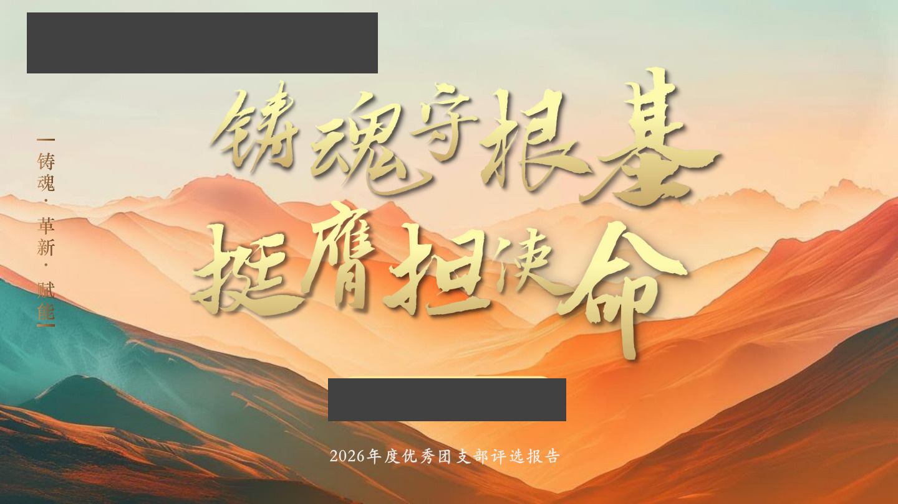

**提炼：**分层场景形成纵深，标题有字形与大小变化，落款与主体分层。背景语言可延伸至全稿：首尾表现较强，正文用轻内底与主题带或外缘色域呼应。

**迁移：**先选择适合本次内容的场景、几何、材质或图形语言，再确定字体与色彩。正文外缘与内部背景有所区别，可以用勾勒线、宽色边或上下主题带建立层次。

**调整边界：**山景、金色字、橙青色和具体书法字体是示例外观，不是默认风格。重新调整对比、阴影、字号与信息空间。

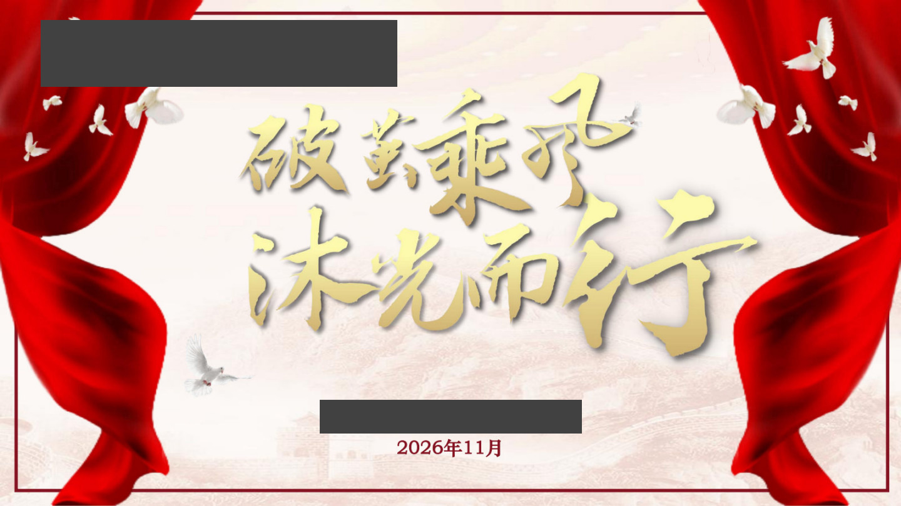

此图可观察主题形象与简短题字共同建立仪式感的方法。红绸、金字和学校标识按当前任务选用；封面造型不直接铺满全部正文页。

**人物型封面的另一种构建：**主标题与人物/集体主图分别形成重心，身份与评选对象靠近主图，底部窄照片带补充经历。参考[补充拼图第 7 页左上封面](../assets/additional-style-boards.pdf)。用独立标题、人物图、身份文本和辅图构建；人物数量、位置和主题色按任务变化。其余小缩略图不支持复原精确文字或字体。

## 固定导航

**适用：**大部分正文页；封面、章节过渡与结尾可例外。

**提炼：**左侧当前标题变化，整组章节标签的文字、顺序、位置和尺寸稳定；通过高亮指出讲述进度。

**迁移：**一次拟定全稿标签，字数、句式、动宾结构和概括层级平行。导航可放顶部或底部；当前标题说明眼前内容，导航说明全稿位置。高亮可通过底色、描边、字色或位置连续变化。

**调整边界：**重新设计标签造型、具体文字、色彩和字体，不复制示例目录。标题、导航和结论条各自有用途，不堆叠重复内容。

## 照片组与图注

**适用：**活动、实践、工作现场，以及需要照片和报告共同证明的成果。

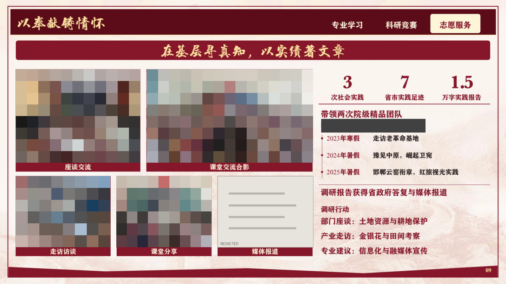

**提炼：**主辅照片、数据、行动说明和报道互补；重要报道拥有独立阅读面积。照片下方用纯色图注带说明具体场景，使图片组工整紧凑。

**迁移：**先选主图再安排辅图；按主体裁切而不拉伸。图注带可贴在照片下方或覆盖底部一小部分，组内高度、字体、内边距与对齐协调。图注与照片成组处理，避免遮住人物、证书或报道的关键内容。

**调整边界：**照片数量、位置和区块比例依材料决定，不固定为左侧照片墙。图注依据真实内容命名，不推定日期、地点或实践归属。

**提炼：**每项活动有明确名称，拼贴、上下照片与主辅图可在同页组合，兼顾统一与变化。

**迁移：**按活动关系分组，组内构图随照片横竖与重要性变化。窗口式外壳只是可选载体，重新设计其边界、裁切、间距和说明；不固定复制三等宽框或界面按钮。

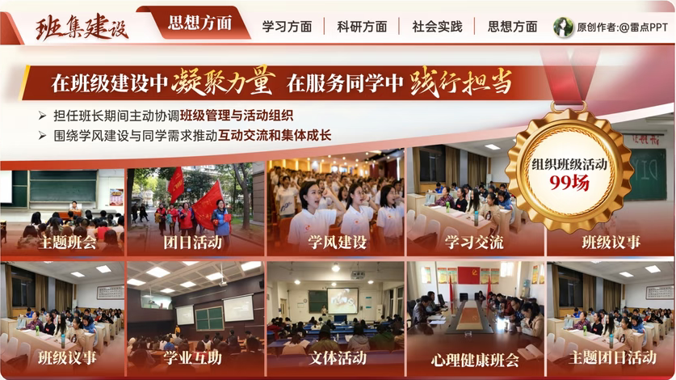

**职责、照片与统计的组合：**先用简短文字交代承担的工作，再以带标签的照片组说明活动种类，用一个可信统计概括覆盖或规模。可用结论条、角色说明、照片网格和统计徽章四类独立对象构建；图片多时按活动分组，徽章不遮挡关键场景。参考[补充拼图第 6 页中央正向大页](../assets/additional-style-boards.pdf)，不复原其两侧被遮挡页或下方缩略页的小字。

## 问题与行动对应

**适用：**评优中的研究经历、团队或组织工作、服务实践等需要交代具体起点与障碍。

**图示来源：**补充图 3 下半与图 4 下半的实际 PPT 页面；仅借鉴以下关系。

**内容关系：**一个核心问题可拆成若干具体表现，每项响应对应真实行动及结果，照片提供问题或行动的情境。

**构建：**先列清问题与行动的对应，再分配问题区、响应区和证据区域；可以左右对照、上下承接或编号连接。用独立短标题、说明文本、照片与连接线构建，重复字段对齐，突出主问题。

**调整边界：**问题数、响应数和分区位置由材料决定，不能把不相关事项用箭头强接。背景依据用可辨识标题与相关内容；补充拼图第 5 页下半的模糊文档只提示“依据区域”，不提供可引用的正文。

## 同构记录

**适用：**并列展示几项代表工作、活动、方向或服务。

**图示来源：**补充图 5 上半的实际 PPT 页面。

**内容关系：**同级事项采用相同的信息顺序，便于横向比较；每项内部仍有主次。

**构建：**每条由编号或标识、短标题、关键说明和对应照片组成，重复记录沿主轴排列。先对齐标题、说明和图片边界，再按信息量调整行高与照片比例；也可转换为纵向或横向组。

**调整边界：**不固定三条，不复制示例的民族纹样或曲线。真实信息有不同层级时改用分组或递进，不能为了整齐强做同级。

## 科研条目

**适用：**评优材料中的多项论文、研究工作或项目，需要同时交代方向、成果与贡献；讲述深度服从当前评选目标。

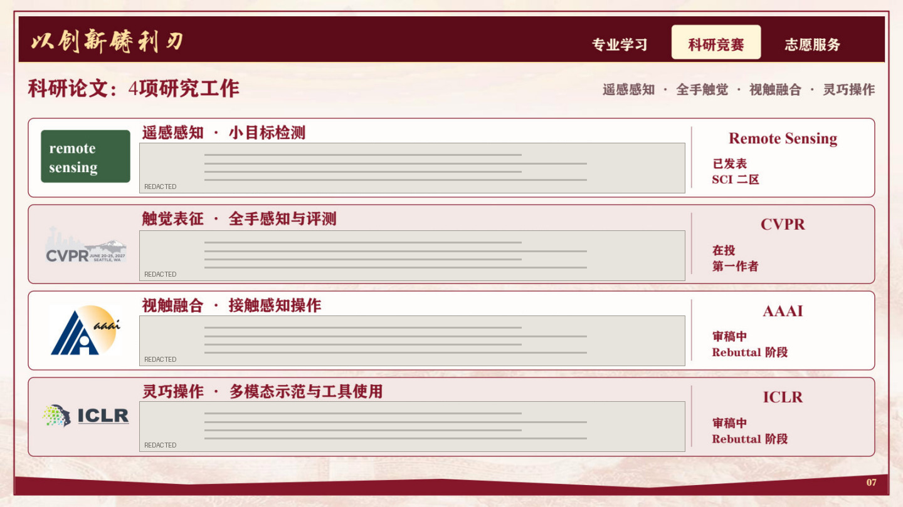

**提炼：**方向标签、题名/引用、标识、贡献或状态分层，行内字段对齐；中文、英文和强调信息各有字体角色。

**迁移：**依据条目长短选择列表、交替底色、分组或与图像结合。最重要的题名或成果先被看见，完整引文放次级位置；本人贡献和发表/投稿状态准确呈现。

**调整边界：**不固定四行、固定列数或会议标识位置。标识、海报、流程邮件和正式发表材料各自支持的事实不同，按真实状态使用；图中文字、论文及署名不转为新稿事实。

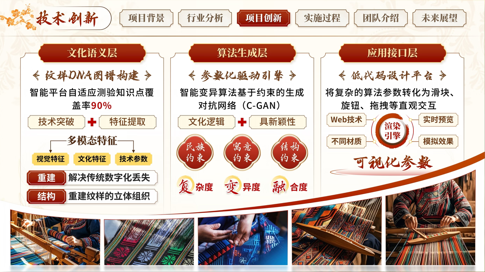

**输入、方法与产出的另一种组织：**从真实链路确定分区，每区呈现一个中心动作、一个产物或证据；区内可分别采用特征分解、机制图和应用场景，底部连续照片带连接整体。参考[补充拼图第 2 页上半、第 3 页上半](../assets/additional-style-boards.pdf)，对应本库“形状化文本与局部图解”的清晰示例。构建时分别保留节点、连接和图像，不把三个装饰盒子当作方法说明，也不固定为三栏。

## 成果分组与证据

**适用：**奖学金、竞赛、项目结项和其他荣誉。

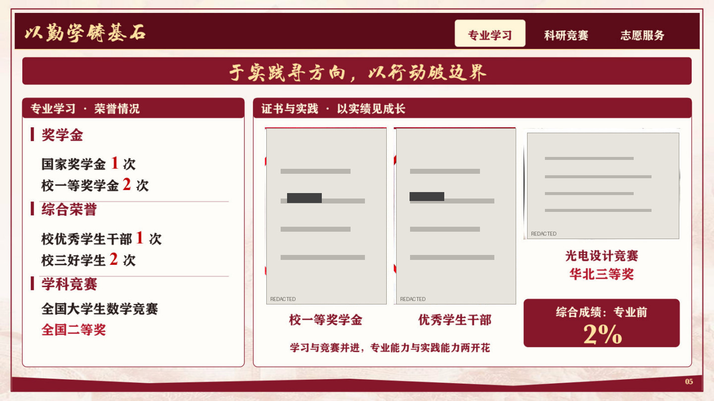

**提炼：**清晰分类的文字、重点成绩与证书对应，避免全部信息同等突出。数字与单位、含义紧邻，重点通过字号、字重和色彩体现。

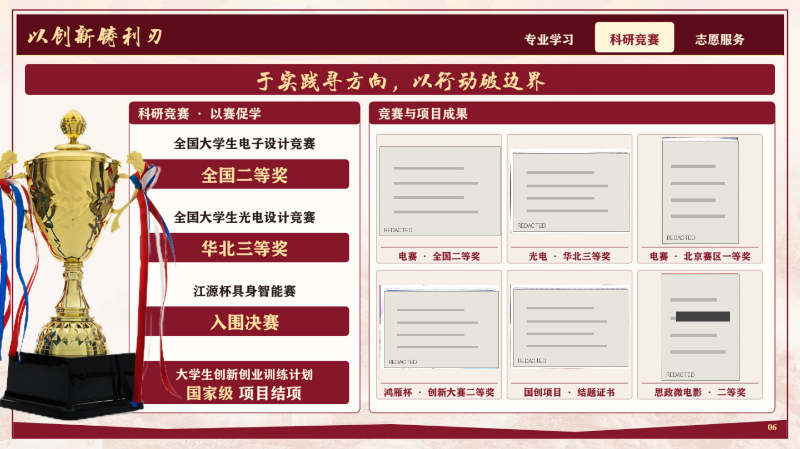

**迁移：**同类证书排列紧凑，外框与间距协调，保留奖项名称和关键信息。可以将文字、证书和主题形象共同组织；装饰有空间才保留，不挤占证据。重要证书单独放大，大量证书可表达成果广度。

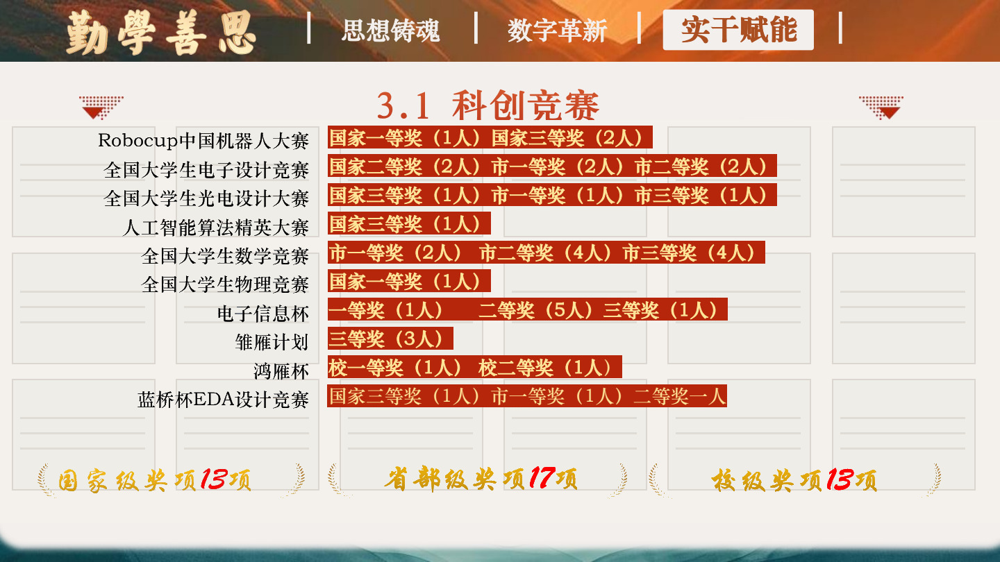

**提炼：**证据拼贴、按赛事整理的结果与分级汇总形成不同阅读层次。

**调整边界：**先确定本次统计口径，再组织代表成果和汇总。区分可核读证据与氛围拼贴，后者不能替代前者。文字色条不是数量条形图，不让长度暗示不真实比例；重做过密文字和背景对比。

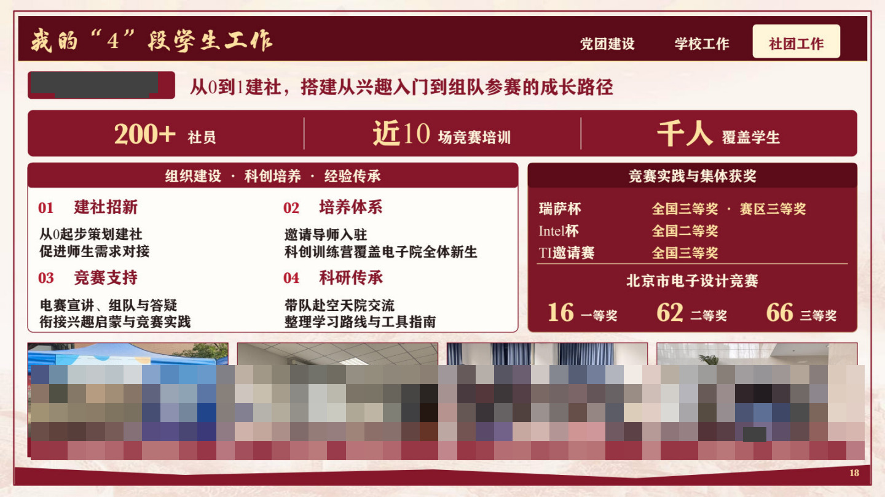

**迁移：**可用深色成果区配浅色文字突出重点，同时保留少量工作场景；按内容改变图文比例、颜色和模块形状。不要把该页列数或奖项布局作为固定格式。

## 流程与反馈机制

**适用：**解释工作如何开展，以及如何通过反馈形成可持续的方法。

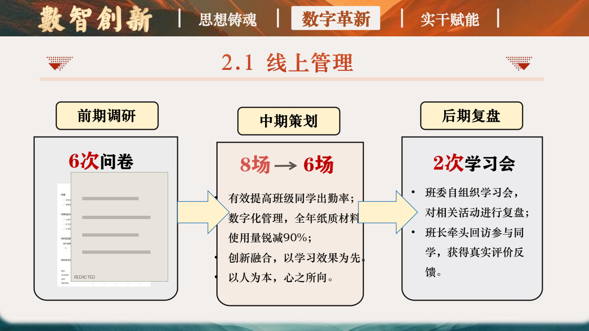

**提炼：**阶段顺序与具体动作、产出或证据对应，评委可以沿流程阅读。

**迁移：**根据真实步骤选择大箭头、路径或分区。阶段数与节点大小由内容决定；箭头不压文字，截图有足够阅读面积。先后顺序不自动证明因果。

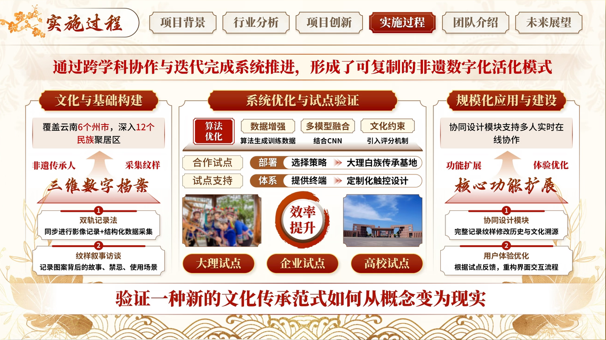

**阶段主区与局部证据：**每阶段包含标题、关键动作和相应证据，重要阶段可以更宽、采用更丰富的内部图解。可用可编辑分区标题、箭头、短标签、照片与结论条组合，阅读顺序先整体后局部。参考[补充拼图第 1 页上半](../assets/additional-style-boards.pdf)；不继承原项目的技术内容、阶段数量或固定栏宽。

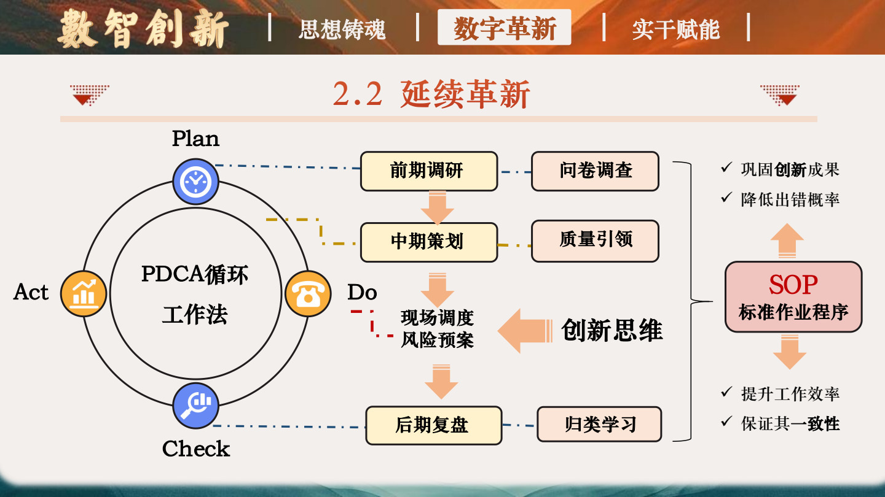

**提炼：**将抽象方法与具体动作、反馈和可复用制度连接，使“做了什么”和“怎样形成机制”同时清楚。

**调整边界：**只有材料具备闭环时才采用循环结构。方法环节与真实动作逐项对应，重整流向与连线层级，不为套 PDCA、SOP 或固定圆环补造环节。

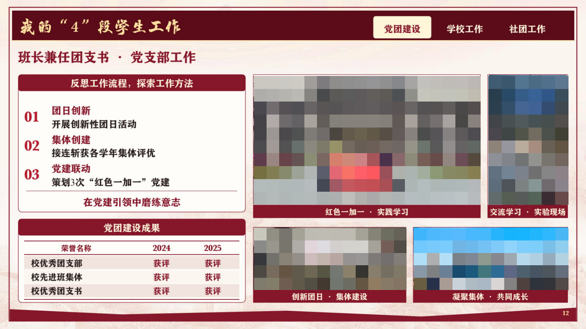

此图提供另一种选择：行动用简短叙述，可比较的年度成果用表格，现场照片补充证据。表格用于适合比较的信息，不要求所有工作叙述都表格化。

## 数据叙事

**适用：**说明活动规模、参与结构、评价反馈和阶段变化。

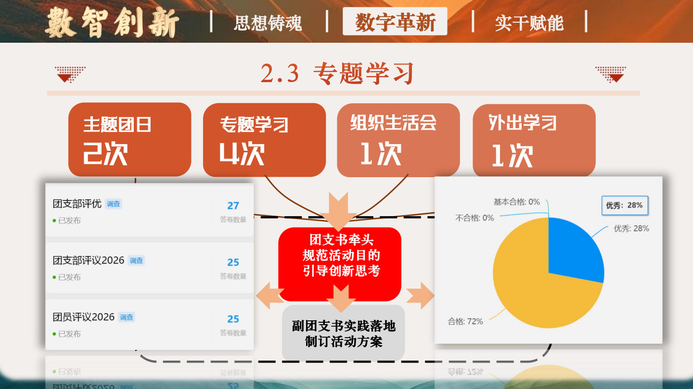

**提炼：**“做了多少、如何组织、反馈如何”可以共同出现，分别由数字、职责图解和调查证据承载。

**迁移：**确定一个主问题，其余内容辅助解释。重做截图、流程和图表的面积关系；标明评价对象、单位和统计口径，不沿用重阴影、镜像倒影或无语义箭头。

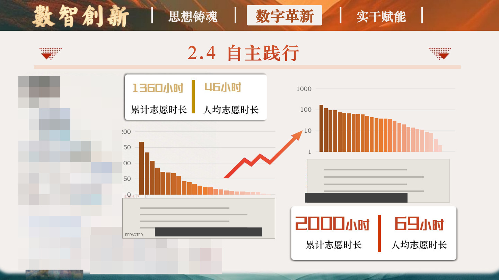

**提炼：**总量与均值概括集体成果，成员分布解释参与结构，照片提供现场情境。

**调整边界：**只借鉴多层数据叙事。前后比较统一口径与可比较尺度；重绘示例中线性与对数尺度并置、过密姓名图例等部分。可以用排序柱形、分组分布或重点注释，不以装饰性上升箭头代替真实趋势。原图数据不作为新稿统计。

## 形状化文本与局部图解

**适用：**文字关系较丰富，或一页包含方法、支撑、输出等多个局部关系。

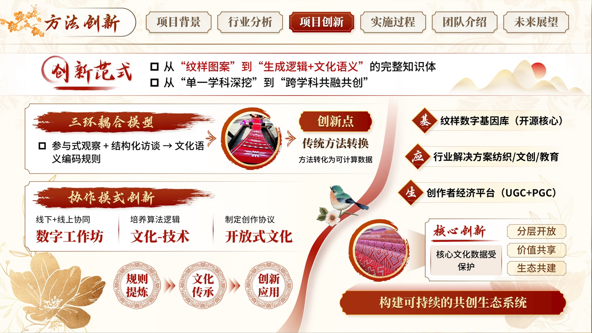

**提炼：**标题签、刷痕色条、圆形徽章、机制框和弧线分区分别承担不同作用，底部结论收束。先看完整页的分区，再关注局部组件；外部宣传包装已排除。可迁移到方法、举措与成效等真实关系。

**提炼：**外层分区协调，各区内部可以采用特征树、并列圆形、中心辐射等不同图解；无需机械复用同一个小模块。

**迁移：**用色块、异形底板、图标、引导线和深浅底组织文字；以少数主关系统领细节。同级元素造型协调，不同关系允许不同造型。线条说明连接、递进或包含，避免仅作装饰。

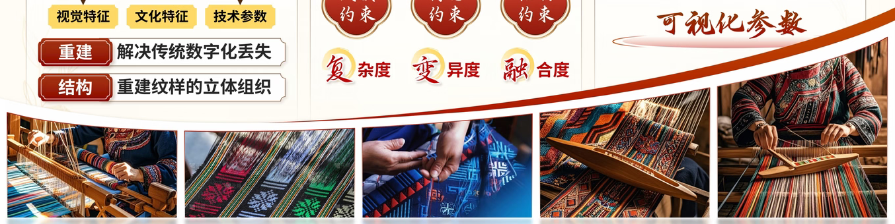

曲线可把信息区与证据照片带连接起来。按内容重设曲线、照片数量和裁切窗口，不固定照抄纹样、三栏或原配色。

**图形关系的构建检查：**先写出每个局部区域表达什么，确定节点、分组、连接和输出，再选标签、徽章、异形底板、自由曲线等造型。标题签、正文、连接线、照片与装饰分别保留可编辑层；曲线用于分区或阅读引导，不能冒充数据。可对照[补充拼图第 4 页上半](../assets/additional-style-boards.pdf)与本节清晰局部图，重画本次真实关系。

## 整页布局与局部构件的选择

新建或大改正文页时，阅读[关系驱动的整页布局与可编辑构建](page-layouts.md)。依据真实关系确定主轴、分层、中心、路径或对应区域，让文字、图片、数字和证据共同构成页面；再按区域需要选择局部构件。

该方法包含层级与金字塔、时间线与阶段、循环与飞轮、中心辐射、并行支撑、双核心、对照、矩阵及数据组织等思路，附正文区大图与 17 类清晰 SVG/PNG。按内容迁移与组合，不固定为小图插入统一卡片，也不固定配色、字体、节点数或参考页的几何位置。

## 空间总结

**适用：**回收全稿核心主题、成长主线或建设路径。

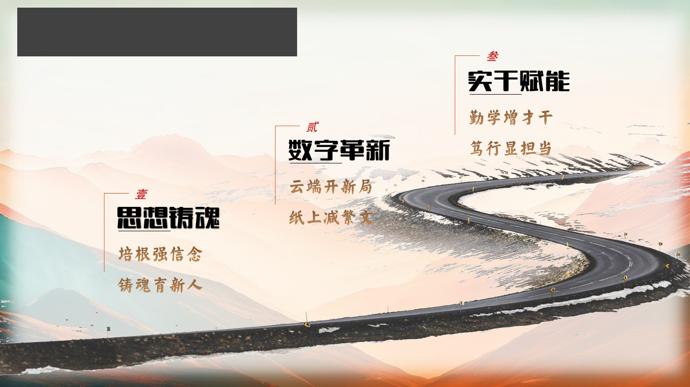

**提炼：**道路将主题放在有联系的位置，文字沿空间路径错落展开，主题背景与总结相互呼应。

**迁移：**依据本次内容选择道路、阶梯、轨迹、桥梁或其他有意义的空间组织。路径有阅读顺序，文字对比清楚；可以沿路径逐步展开或移动焦点。

**调整边界：**道路、山景、三个标题及其位置不是固定格式。总结回收已经展开的事实，不在末页首次加入新成果。

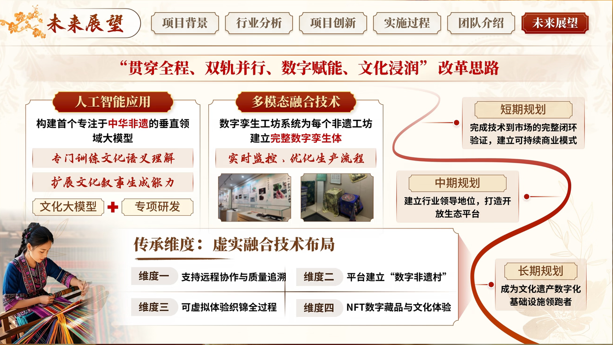

**阶段规划路径：**若表达后续安排，可将阶段节点沿曲线排列，旁边放对应目标与行动，其他方向说明放在独立区域。参考[补充拼图第 1 页下半](../assets/additional-style-boards.pdf)。用可编辑路径、节点和相邻文本构建，阶段数量和位置按安排调整；没有时间/阶段关系时改用普通分组。

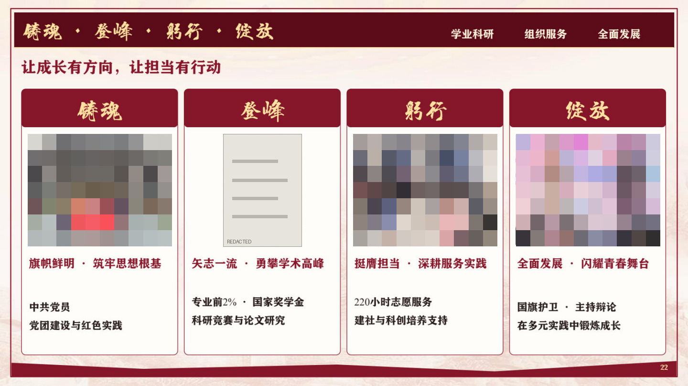

另一种方法是将主题与照片、成果一一对应；适合需要横向回顾多项优势时选用。是否分栏、分几栏由当前主线决定。

## 跨页连续运动

**适用：**相邻页复用照片、文字块、图注、组件或导航。

**提炼：**照片与图注是对应单元，可以共同移动、缩放或接续其他证据。此图仅展示静态构成；运动按本次讲述另行规划。

| 展示关系 | 可选连续运动 |
|---|---|
| 进入新章节 | 固定标签位置，转移高亮或连续改变其底色/字色 |
| 总览进入重点 | 同一照片/组件放大并移至主区，其他内容退让或退出 |
| 连续组图 | 左右或上下胶片式滑动，保持窗口和照片尺寸逻辑，可保留重叠照片作为连续参照 |
| 复用文字或数字 | 维持对象对应，移动、缩放或改变强调，接入新证据 |
| 展开分支或由行动转成果 | 保留关键关系，移动焦点，引入证书、报告或结果数据 |

规划时说明共享对象、固定项、进入/退出项及起止位置；图注随对应照片运动。胶片是移动方式，不要求画齿孔装饰。方向与阅读顺序协调。

制作时保留可识别的对象或合理组合，维护跨页对应，不将需要运动的内容压成整页图。重复页、遮盖或画布外对象按放映逻辑处理。具体实现使用 PPT 制作技能，并核看目标软件中的实际效果。

## 补充拼图的阅读范围

[补充拼图 PDF](../assets/additional-style-boards.pdf)按图片文件名末尾 1—7 排列。以下是图像范围说明，不是新稿页序；具体方法已写在上面的功能条目中。

| 图像/PDF页 | 可判读的区域 | 方法入口与限制 |
|---|---|---|
| 1 | 上下两个较清晰横版页面 | 阶段推进、规划路径；外部宣传标题与口号不进入 PPT |
| 2 | 上半技术页完整；下半为缩略/裁切拼图 | 输入—方法—产出的局部图解；下半只观察整套节奏 |
| 3 | 上半技术页、下半概述页完整可读 | 局部图解、问题与行动对应；技术页与图 2 有重复，不当作独立新结构 |
| 4 | 上半方法页、下半问题页完整可读 | 图解式文本、问题与响应；民族纹样和装饰不是结构要求 |
| 5 | 上下两个大页面可读，文档截图正文模糊 | 同构记录、背景依据分区；不据模糊文档引用事实 |
| 6 | 中央正向大页可读；两侧局部被遮挡，下方为缩略页 | 职责＋照片组＋统计、全稿构图变化；不补写遮挡区和缩略页细节 |
| 7 | 左上封面可读，其余主要是缩略页 | 人物型封面、全稿节奏；不据缩略页推定精确字体、文字和对象结构 |

这些图片不提供原始字体参数、母版、可编辑层或动画。普通重新设计使用已提炼的方法；精确复现依赖未展示细节时才补充清晰页面或原文件。

## 参考文件与使用范围

条目中的裁剪图由原始图片按可见边界截取，不重画、不放大补细节。它们用于理解局部结构与外观；成稿用本次真实素材和可编辑对象重新构建。完整拼图仅用于需要核对上下文时查阅。整页布局大图与结构 SVG/PNG 按[整页布局方法](page-layouts.md)中的对应说明使用。

- [三好学生局部节选](../assets/sanhao-selected.pdf)：用于上列照片、证据、科研、工作与总结方法；不按节选顺序编排新稿。
- [团支部局部节选](../assets/tuan-selected.pdf)：仅包含原文件的封面、特色活动、数字革新、志愿数据、科创竞赛和倒数第二页；背景方法从这些片段观察。其他原始页不在参考包内。
- [主题与密度补充拼图](../assets/additional-style-boards.pdf)：按本库相应功能条目与阅读范围使用，提取内部 PPT 的关系与组织方法。挑战杯部分只取视觉组织，不扩展为技术答辩流程。

参考文件中的身份、成果、数字与状态不进入新稿事实。正文方法由条目限定，不因文件存在就将其中全部装饰或布局作为规范。
